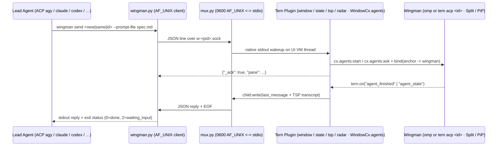

# tern-wingman

<p align="center">
  <b>Fly with live side-pane or Picture-in-Picture agent wingmen (<code>omp</code> by default, or any Tern agent) inside <a href="https://stencil.so/tern">Tern</a>.</b><br>
  Native <code>WindowCx.agents</code> TSP bridge + portable agent skill for Antigravity, Claude Code, Codex, Gemini CLI, OpenCode &amp; more.
</p>

<p align="center">
  English · <a href="README.zh-CN.md">简体中文</a> · <a href="CHANGELOG.md">Changelog</a>
</p>

<p align="center">
  <a href="LICENSE"></a>
  
  
  
</p>

---

**`tern-wingman`** lets any coding agent running inside a [Tern](https://stencil.so/tern) pane delegate implementation, refactoring, and heavy test runs to live wingman agents right beside it — or floating in a Picture-in-Picture corner. The default wingman is **[oh-my-pi (`omp`)](https://github.com/can1357/oh-my-pi)**; `--agent ID` launches any other Tern agent (`claude`, `codex`, `copilot`, or a custom one) via `tern acp`. Wingmen can have wingmen of their own (multi-level trees).

Instead of emulating terminal keystrokes (`paste` + `Enter`, which breaks across 4 KB PTY buffers and steals focus) or polling multi-hundred-MB `.jsonl` logs on disk, `tern-wingman` drives Tern's own **`WindowCx.agents`** engine over the **Tern Surface Protocol (TSP)**:

- **Atomic TSP prompt delivery (`cx.agents:start` / `cx.agents:ask`)** — prompts are queued natively by Tern until the agent reports `sendable=true` and delivered as a single atomic TSP `send` event, regardless of length.
- **Zero-polling `AF_UNIX` event bus (`tern.process.spawn` + `agent_finished`)** — zero `.jsonl` polling, zero timer directory scans, and zero ephemeral TCP ports; `window.luau` wakes `wingman.py` over a `0600` UNIX domain socket in `2–10 ms` (even when occluded on Wayland) and survives live `tern plugin reload`.
- **Explicit `anchor → wingman` ownership graph & FIFO queueing** — ACP lead agents (`agy`, `claude`, `codex`) never target themselves or collide in multi-agent tabs; binding a pane to itself or an ancestor is rejected with a cycle error before any effect. Sending to a busy worker queues natively in `window.luau` (`unqueue` cancels pending slots), and `same` / `interrupt` / `pip` track the bound worker across `ovnfs` checkouts and subdirectory changes.
- **Full-duplex bidirectional callbacks (`report` + Auto-Callback)** — if a worker finishes an unsolicited follow-up turn (such as an internal background job completing after the lead agent went `idle`), `window.luau` automatically pushes the completion back into the lead agent's composer (coalescing if busy, and adding an explicit UTF-8-safe truncation notice past 3,600 bytes pointing to `wingman transcript`); workers can also push mid-turn progress or questions proactively via `wingman report -m "..."` (or `-m -` for piped stdin).
- **In-memory structured transcripts (`cx.agents:transcript`)** — read recent turns and tool cards straight from Tern's live TSP memory without touching disk.
- **Non-intrusive Splits & Dynamic Picture-in-Picture (`--pip`)** — spawns splits without yanking keyboard focus away from your lead agent (even across background tabs), stacks additional right-column workers cleanly, scales PiP windows dynamically to the owner's tab share with automatic free-corner selection (`br → tr → bl → tl`), and `unpark`s workers beside their owner.
- **Native Live Panel (`radar.luau` + `radar_view.luau`)** — a Tern canvas showing the `owner → wingman` topology, Living Files, and recent tool calls, with one-click Focus / PiP / Dock / Interrupt / Retry / Unqueue. Sidebar width is remembered when dragged, floating size scales across resolutions and OSes, and Living Files / activity budgets adapt dynamically to panel size and active load.
- **Mechanism, not policy** — zero prompt rewriting and zero hidden config overrides; the lead agent decides per task whether to open a fresh session (`new`), iterate in place (`same`), resume a specific session, or isolate risky changes in an [`ovnfs`](https://github.com/stencil-hq/ovnfs) copy-on-write checkout.

## Architecture



The Tern plugin is split into five acyclic Luau modules: `window.luau` (RPC router, turn/queue/callback state machine, dynamic worker placement), `state.luau` (`owners_v1` 1-to-N graph, `bindings_v1` migration, cycle guard), `tsp.luau` (stateless TSP/surface helpers, ACP `layer` dialog extraction, UTF-8 clipping), `radar.luau` (Live Panel controller & 50 ms budget guard), and `radar_view.luau` (pure declarative CSS + UI renderer).

## Install

Both halves install directly from the repository root:

```sh
# 1. Install the Tern window plugin (hot-loads immediately)
tern plugin install github.com/ninthcj/tern-wingman

# 2. Install the agent skill (Claude Code, Cursor, Codex, OpenCode, Goose, …)
npx skills add ninthcj/tern-wingman
```

Custom agents (any id other than `omp`/`claude`/`codex`/`copilot`, e.g. `agy`) are not installed by this plugin: add them in Tern **Settings › Agents** (id, name, command, args, env) before using `--agent <id>`.

<details>
<summary><b>Manual / Antigravity / Local checkout setup</b></summary>

```sh
git clone https://github.com/ninthcj/tern-wingman.git
tern plugin link ./tern-wingman

# Symlink into Antigravity's or ~/.agents' skills folder:
ln -s "$(pwd)/tern-wingman/skills/wingman" ~/.gemini/config/skills/wingman
# or:
ln -s "$(pwd)/tern-wingman/skills/wingman" ~/.agents/skills/wingman

# Optional (recommended): put `wingman` directly on PATH for one-word CLI calls:
ln -sf "$(pwd)/tern-wingman/skills/wingman/scripts/wingman.py" ~/.local/bin/wingman
```

Verify the plugin is `ready`:

```sh
tern plugin list
# wingman 0.6.0 Wingman — 0 blocks, 0 lenses, window  ready
```

</details>

## Live Panel

Toggle it from the palette (**Wingman: Toggle Live Panel**) or add the **Wingman** widget to the widget bar (palette → *Edit widgets…* → *Plugins*); the widget shows working / waiting / queued counts and toggles the panel on click. The canvas opens as a sidebar on the far right of the tab without taking focus and survives `tern plugin reload`. Dragging the sidebar divider remembers your preferred width (`sidebar_share` in `radar_v1`). The button beside *Tab* / *All* floats it as a proportionally sized corner PiP over the rightmost pane or docks it back; both the mode and the corner you drag the float to are remembered across resolutions and OSes.

- **Topology** — each owner with its bound wingmen: state, time in state, queued prompts, fault flag. Click a row to focus its pane; per-row PiP/Dock, Interrupt, Retry (after a fault) and Unqueue run the same cores as the CLI ops.
- **Living files** — per repository, `git status` merged with files agents edited (including external edits) or read in recent tool calls, with cross-OS path normalization; click to open. Read-only entries are capped dynamically from the panel's available height and active load, folding overflow into `… N more`, and *Clear reads* hides them on demand.
- **Activity** — each working agent's card shows its current tool and a loom strip of recent calls colored by kind (read / search / edit / run / error, the running one pulsing), with strip length and recent-call feed count adapting dynamically to the panel's width/height share (`cx.agents:transcript`, for `omp` and ACP panes alike).
- **Stage & dock** — working / waiting / queued / fault tiles under a glow that follows the agents' mood, *Tab* / *All* scope (persisted), *Open Git*, *Clear reads*, and a health dot whose tooltip shows the panel's measured cost per render.

Budget (Tern pauses a window hook whose call runs past 50 ms of Lua, and every timer shares one hook with the wingman watchdog): while closed the panel only keeps per-agent counts for the widget — no timer, transcript or git work. While open it re-renders on agent events and ticks only while an in-scope agent is working, spaced to keep under 2 % of the window thread; `git status` runs once per repository, is never re-issued while pending, and is asked less often the slower it is. Each render times its Lua and native parts; past 10 ms of Lua (or 100 ms wall) it drops transcript sampling ("lite") for a cooldown that doubles like Tern's own pause. It never reads `cx.session:surface` (~20 ms per omp pane).

## CLI Reference (`wingman.py`)

`wingman.py` requires only Python 3.10+ standard library (**Linux, macOS & Windows**). Outside Tern (or with `--mode headless`), `send` automatically falls back to detached `omp -p --wait-async --auto-approve`; this headless fallback is `omp`-only.

```sh
# Inspect live Tern TSP agents, PiP floats, ovnfs availability, and recent sessions
python3 skills/wingman/scripts/wingman.py info --cwd /path/to/project

# Dispatch work: 'new' ADDS another wingman (never closes or replaces an existing one); 'same' reuses one
python3 skills/wingman/scripts/wingman.py send new \
  --cwd /path/to/project \
  --prompt-file /path/to/spec.md

# Choose placement for a new/existing worker: split (default) | down | pip | tab | park
python3 skills/wingman/scripts/wingman.py send new --layout down --prompt "Add tests for parser.py"
python3 skills/wingman/scripts/wingman.py send new --layout pip --pip tr --prompt "Watch the build"  # --pip tr works by itself too

# Any Tern agent as wingman (launched as `tern acp <id>`); model / explicit resume / latest (= native --continue)
python3 skills/wingman/scripts/wingman.py send new --agent claude --model <model> --prompt "Review the diff"
python3 skills/wingman/scripts/wingman.py send <session-id> --agent codex --prompt "Continue"   # Wingman passes native --resume <session-id>
python3 skills/wingman/scripts/wingman.py send latest --agent claude --prompt "Pick up where you left off"

# Several wingmen bound? Target one exactly with --pane; replacement is explicit and never automatic
python3 skills/wingman/scripts/wingman.py send same --pane <id> --prompt "Run pytest -q"
python3 skills/wingman/scripts/wingman.py send new --replace --prompt "Start over"   # closes the sole/unique-cwd bound worker; errors if none or ambiguous

# Read structured TSP chat messages & tool cards directly from Tern memory
python3 skills/wingman/scripts/wingman.py transcript --last 6
# Worker blocked on ask/approval (waiting_input): inspect the card, then answer via TSP events
python3 skills/wingman/scripts/wingman.py surface --pane <id> [--json]
python3 skills/wingman/scripts/wingman.py event --pane <id> '{"ev":"action","id":"<id>","act":"pick:0:0"}' '{"ev":"action","id":"<submit_id>","act":"submit"}'
# Worker turn failed/aborted (supervisor gets `[Wingman fault · retryable · pane <id>]`): native `/retry`, same as F5
python3 skills/wingman/scripts/wingman.py retry --pane <id>

# Float to PiP (corner br|bl|tr|tl), dock back, park (hide; omp keeps running) / unpark, interrupt, cancel queued, close
python3 skills/wingman/scripts/wingman.py pip --corner br
python3 skills/wingman/scripts/wingman.py dock --dir right
python3 skills/wingman/scripts/wingman.py park --pane <id>
python3 skills/wingman/scripts/wingman.py unpark --pane <id>
python3 skills/wingman/scripts/wingman.py interrupt
python3 skills/wingman/scripts/wingman.py unqueue
python3 skills/wingman/scripts/wingman.py stop

# Bidirectional worker -> supervisor reporting & auto-callback policy
python3 skills/wingman/scripts/wingman.py report -m "Finished v4 pipeline; ready for review"
python3 skills/wingman/scripts/wingman.py callback [status|on|off|reset]
```

### Pairing with `deja-vu` & `ovnfs`

- **Cross-agent memory ([deja-vu](https://github.com/vshulcz/deja-vu))**: `deja` indexes transcripts across 48 coding agents alongside `omp`, giving your lead agent instant historical recall while `tern-wingman` owns live TSP execution.
- **Zero-copy sandboxes ([ovnfs](https://github.com/stencil-hq/ovnfs))**: Run risky refactors or parallel A/B tasks by passing `--cwd "$(ovnfs new .)"`, reviewing with `ovnfs diff`, and landing with `ovnfs apply`.

### Agents & constraints

`send --agent ID` defaults to `omp`. For other agents the worker starts as `tern acp <id>` with optional `--model`; a positional session ID (`send <session-id> --agent claude …`) is passed to the agent as native `--resume <session-id>` (Wingman itself has no `--resume` flag), `latest` maps to native `--continue`, `new` starts fresh. The working directory comes from the pane layout (`--cwd`). Rejected for non-`omp` agents rather than emulated: `--mode headless`, `--thinking`, and the `omp`-specific `--takeover-idle` / `--allow-fork`. Custom ids must be lowercase letters, digits, `.`, `_`, `-` (≤64 chars, no leading `-`). `same` and controls reuse or adopt any live unowned agent in the same tab (preferring a matching cwd) regardless of `--agent`. `info` reports each agent's `kind`. `send` / `retry` default to async when the caller itself is a Tern agent; `retry` is the `omp` `/retry` fault-recovery path.

**Hidden ACP agents:** on Tern 0.9.30 a hidden ACP agent (parked, or in a background tab) accepts a prompt but keeps it queued until its pane is shown or unparked. For unattended work and callback delivery with ACP agents use `split`, `down` or `pip` in the current tab; `unpark`/show the pane before expecting queued ACP prompts or callbacks. `omp` keeps running and responding while parked.

### Multiple wingmen & placement

One owner can run several wingmen at once, and wingmen can own wingmen. `send new` adds a worker; `send new --replace` closes only the selected bound worker before launching its replacement. `send same` and controls select the sole bound worker automatically. With several, use `--pane <id>` or an explicit `--cwd` that matches exactly one; ambiguous commands list the bound IDs. `info` reports sorted `boundWingmanPanes` and retains `boundWingmanPane` when there is exactly one.

`--layout` selects placement (default `split` for a fresh worker; an existing target keeps its placement unless `--layout` is given):

| Layout | Use for |
| --- | --- |
| `split` | primary worker beside the supervisor; additional `split`/`dock` workers stack cleanly in the right column |
| `pip` | lightweight worker or watcher, dynamically sized to the owner's tab share (`--pip tl\|tr\|bl\|br` pins a corner and implies `--layout pip`; omitting the corner picks the first free corner `br → tr → bl → tl`) |
| `down` | second worker, stacked under the right-side worker |
| `tab` | independent unfocused tab for a 3rd+ or noisy worker |
| `park` | hide a live worker; `omp` keeps running and responding while parked, but a hidden ACP agent queues prompts until `unpark` |

New workers open without taking focus. The Live Panel shows all wingmen of an in-tab supervisor, even those parked or in another tab. Use `park` and `unpark` to hide and show a live worker without stopping it.

## Development & Tests

```sh
tern plugin types .                          # optional: generate tern.d.luau for luau-lsp
python3 -m unittest discover -s tests -v     # run unit & loopback bridge tests
```

## License

[MIT](LICENSE) © [ninthcj](https://github.com/ninthcj)
