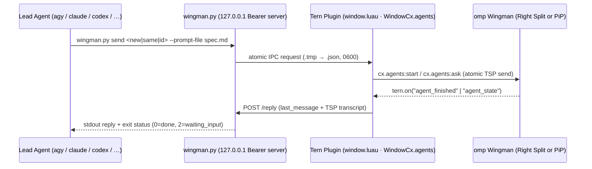

# tern-wingman

<p align="center">
  <b>Fly with a live side-pane or Picture-in-Picture <code>omp</code> wingman inside <a href="https://stencil.so/tern">Tern</a>.</b><br>
  Native <code>WindowCx.agents</code> TSP bridge + portable agent skill for Antigravity, Claude Code, Codex, Gemini CLI, OpenCode &amp; more.
</p>

<p align="center">
  English · <a href="README.zh-CN.md">简体中文</a>
</p>

<p align="center">
  <a href="LICENSE"></a>
  
  
  
</p>

---

**`tern-wingman`** lets any coding agent running inside a [Tern](https://stencil.so/tern) pane act as lead architect/supervisor while delegating implementation, refactoring, and heavy test runs to a live **[oh-my-pi (`omp`)](https://github.com/can1357/oh-my-pi)** wingman right beside it — or floating in a Picture-in-Picture corner.

Instead of emulating terminal keystrokes (`paste` + `Enter`, which breaks across 4 KB PTY buffers and steals focus) or polling multi-hundred-MB `.jsonl` logs on disk, `tern-wingman` drives Tern's own **`WindowCx.agents`** engine over the **Tern Surface Protocol (TSP)**:

- **Atomic TSP prompt delivery (`cx.agents:start` / `cx.agents:ask`)** — prompts are queued natively by Tern until `omp` reports `sendable=true` and delivered as a single atomic TSP `send` event, regardless of length.
- **Event-driven completion (`agent_finished` & `agent_state`)** — zero `.jsonl` polling; the Luau window half notifies `wingman.py` over authenticated `127.0.0.1` loopback HTTP the millisecond a turn settles or enters `waiting_input`.
- **In-memory structured transcripts (`cx.agents:transcript`)** — read recent turns and tool cards straight from Tern's live TSP memory without touching disk.
- **Non-intrusive Splits & Picture-in-Picture (`--pip br`)** — spawns splits without yanking keyboard focus away from your lead agent (even across background tabs), and floats/docks the wingman as a corner PiP overlay on demand.
- **Mechanism, not policy** — zero prompt rewriting and zero hidden config overrides; the lead agent decides per task whether to open a fresh session (`new`), iterate in place (`same`), resume a specific session, or isolate risky changes in an [`ovnfs`](https://github.com/stencil-hq/ovnfs) copy-on-write checkout.

## Architecture



## Install

Both halves install directly from the repository root:

```sh
# 1. Install the Tern window plugin (hot-loads immediately)
tern plugin install github.com/ninthcj/tern-wingman

# 2. Install the agent skill (Claude Code, Cursor, Codex, OpenCode, Goose, …)
npx skills add ninthcj/tern-wingman
```

<details>
<summary><b>Manual / Antigravity / Local checkout setup</b></summary>

```sh
git clone https://github.com/ninthcj/tern-wingman.git
tern plugin link ./tern-wingman

# Symlink into Antigravity's or ~/.agents' skills folder:
ln -s "$(pwd)/tern-wingman/skills/wingman" ~/.gemini/config/skills/wingman
# or:
ln -s "$(pwd)/tern-wingman/skills/wingman" ~/.agents/skills/wingman
```

Verify the plugin is `ready`:

```sh
tern plugin list
# wingman 0.1.0 Wingman — 0 blocks, 0 lenses, window  ready
```

</details>

## CLI Reference (`wingman.py`)

`wingman.py` requires only Python 3.10+ standard library (Linux & macOS). Outside Tern (or with `--mode headless`), `send` automatically falls back to detached `omp -p --wait-async --auto-approve`.

```sh
# Inspect live Tern TSP agents, PiP floats, ovnfs availability, and recent sessions
python3 skills/wingman/scripts/wingman.py info --cwd /path/to/project

# Dispatch work to a fresh session ('new'), active pane ('same'), or specific session ID
python3 skills/wingman/scripts/wingman.py send new \
  --cwd /path/to/project \
  --thinking high \
  --prompt-file /path/to/spec.md

# Dispatch directly into a bottom-right Picture-in-Picture floating pane
python3 skills/wingman/scripts/wingman.py send same --pip br --prompt "Run pytest -q and fix the failing edge case"

# Read structured TSP chat messages & tool cards directly from Tern memory
python3 skills/wingman/scripts/wingman.py transcript --last 6

# Float to PiP, dock back into split, interrupt Ctrl-C, or close worker
python3 skills/wingman/scripts/wingman.py pip --corner br
python3 skills/wingman/scripts/wingman.py dock --dir right
python3 skills/wingman/scripts/wingman.py interrupt
python3 skills/wingman/scripts/wingman.py stop
```

### Pairing with `deja-vu` & `ovnfs`

- **Cross-agent memory ([deja-vu](https://github.com/vshulcz/deja-vu))**: `deja` indexes transcripts across 48 coding agents alongside `omp`, giving your lead agent instant historical recall while `tern-wingman` owns live TSP execution.
- **Zero-copy sandboxes ([ovnfs](https://github.com/stencil-hq/ovnfs))**: Run risky refactors or parallel A/B tasks by passing `--cwd "$(ovnfs new .)"`, reviewing with `ovnfs diff`, and landing with `ovnfs apply`.

## Development & Tests

```sh
tern plugin types .                          # optional: generate tern.d.luau for luau-lsp
python3 -m unittest discover -s tests -v     # run unit & loopback bridge tests
```

## License

[MIT](LICENSE) © [ninthcj](https://github.com/ninthcj)
